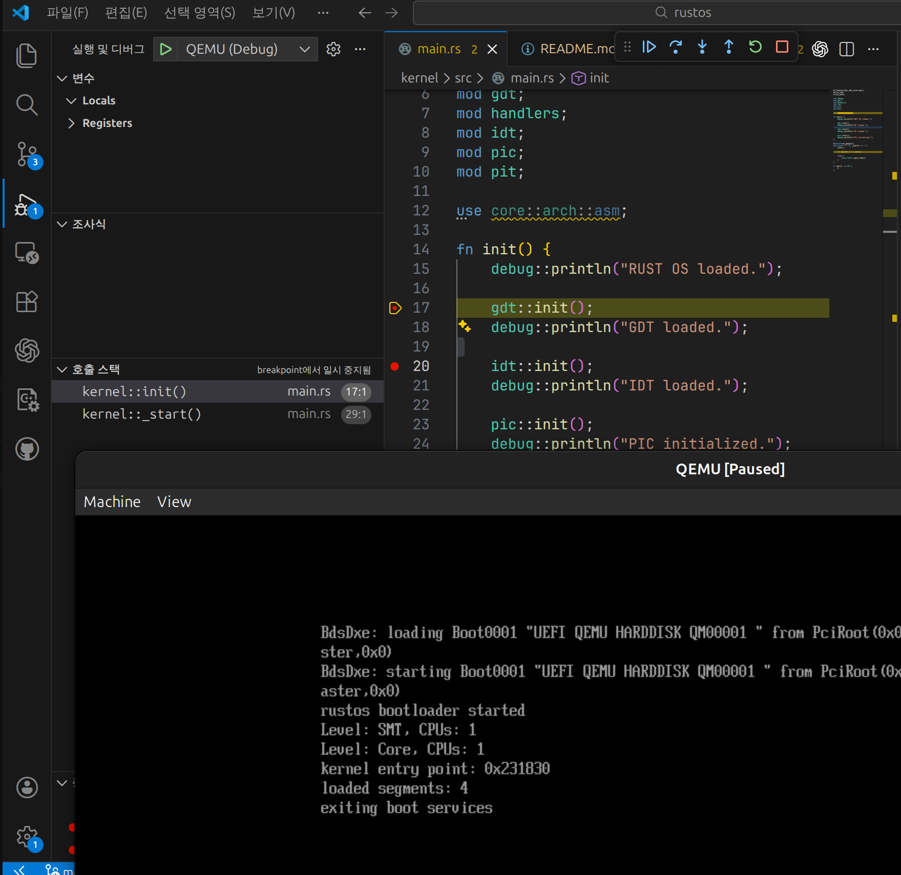

# RustOS

[](https://github.com/ierwarf/rustos/actions/workflows/rust.yml?branch=master)
[](https://ierwarf.github.io/rustos/)
[](LICENSE)

> An experimental Rust-first hybrid microkernel operating system with userspace
> services, Linux ELF / Windows PE compatibility work, a Wayland desktop, and a
> Linux driver domain.



[English](#english) · [한국어](#korean) · [Documentation](https://ierwarf.github.io/rustos/)

---

<a id="english"></a>

## English

### Overview

RustOS is a Rust-built **hybrid microkernel** organized as an operating-system
platform rather than a single kernel crate. Ring0 keeps the mechanisms that
need kernel privilege—trap entry, paging, scheduling, IRQ/MMIO/DMA bridges,
and a small set of gated brokers—while higher-level policy is moved into
userspace services.

The project targets native binary compatibility for **Linux ELF** and
**Windows PE** programs. `uiserver` includes a Wayland compositor that provides
the desktop surface for native and compatibility clients.

### Highlights

- **Hybrid microkernel design** — privileged mechanisms stay in ring0 while
  policy and higher-level functionality move to userspace services.
- **Rust-first workspace** — layered kernel crates, service binaries, shared
  libraries, tools, and manifests live in one development workspace.
- **Dual compatibility direction** — Linux ELF and Windows PE compatibility
  are developed against the same OS architecture rather than as separate
  systems.
- **Wayland desktop** — the built-in compositor in `uiserver` owns the desktop
  surface.
- **Manifest-driven images** — `cargo xtask` validates, builds, stages, and
  assembles the UEFI boot image.
- **Linux driver domain** — KVM smoke testing boots the pinned Buildroot Linux
  DVM alongside RustOS and can exercise its authenticated input, display,
  network, and read-only block test transports.

### Build flow

```text
cargo xtask build
        │
        └──> build/rustos-boot.img
                 │
                 └──> GRUB EFI -> RustOS
```

The staged boot volume lives at `build/image`, the generated disk image is
`build/rustos-boot.img`, and the default UEFI entry is
`build/image/EFI/BOOT/BOOTX64.EFI`.

### Quick start

See [Getting Started](docs/getting-started.md) for host prerequisites and the
full setup procedure.

```bash
cargo xtask check
cargo xtask build
cargo xtask kvm-smoke --dry-run
```

For the Linux driver-domain smoke path, use `qemu-system-x86_64` with
read/write `/dev/kvm` and `/dev/vhost-vsock` access. The virtual display also
requires exactly one accessible AMDGPU render node; see the full
[host prerequisites](docs/getting-started.md#kvm-parallel-boot-smoke).

```bash
cargo xtask build-dvm
cargo xtask kvm-smoke --expect 'runtimed: bootstrap ui done'
```

The DVM exposes a hash-bound `agent-v1-control` handshake and bounded
input, display, network, and read-only block transports. The base smoke test
checks boot and control readiness; optional KVM flags exercise the individual
relay paths. Virtual-device evidence does not establish physical GPU,
storage passthrough, host input capture, or commercial release readiness.

### Architecture at a glance

| Area | Role |
| --- | --- |
| Boot | GRUB EFI boot path and generated UEFI disk image |
| Ring0 | Trap entry, paging, scheduling, IRQ/MMIO/DMA bridges, gated brokers |
| Userspace | OS policy and higher-level services |
| UI | `uiserver` Wayland compositor and desktop surface |
| Compatibility | Linux ELF and Windows PE compatibility work |
| Driver domain | Buildroot Linux DVM with authenticated control and bounded device relays |
| Tooling | `cargo xtask`, manifests, staging, verification, and KVM orchestration |

### Project status

| Area | Status |
| --- | --- |
| GRUB EFI boot manager | Present |
| Layered kernel crates | Present |
| Manifest-driven image staging | Present |
| Userspace services | Present |
| Wayland/framebuffer desktop UI | Present |
| Linux ELF compatibility | In progress |
| Windows PE compatibility | In progress |
| Linux DVM control smoke path | Present |
| DVM input/display/network/read-only block test paths | Present in bounded KVM topologies |
| Public release artifacts | Planned |

### Documentation

A good reading order is:

1. [Getting Started](docs/getting-started.md)
2. [Execution Flow](docs/execution-flow.md)
3. [Microkernel Overview](docs/architecture/microkernel-overview.md)
4. [Userspace Services](docs/architecture/services.md)
5. [Userspace Compatibility](docs/architecture/userspace-compat.md)
6. [UI Server & Wayland](docs/architecture/ui-server.md)
7. [Structure Guide](docs/structure.md)
8. [Kernel API](docs/api/kernel.md)
9. [xtask API](docs/api/xtask.md)
10. [Logging Guide](docs/logging.md)
11. [AI Agent Reference](docs/ai/README.md)

Full documentation is also published through the
[mdBook site](https://ierwarf.github.io/rustos/).

---

<a id="korean"></a>

## 한국어

### 개요

RustOS는 Rust로 작성된 **hybrid microkernel** 운영체제이며, 단일 kernel
crate가 아니라 하나의 OS 개발 플랫폼 형태로 구성되어 있습니다. ring0에는
trap entry, paging, scheduling, IRQ/MMIO/DMA bridge, 소수의 gated broker처럼
커널 권한이 필요한 mechanism만 남기고, 상위 정책과 기능은 userspace
service로 옮기는 방향을 사용합니다.

프로젝트는 **Linux ELF**와 **Windows PE** 프로그램의 native binary
compatibility를 목표로 합니다. `uiserver`에는 native/compatibility client가
사용하는 desktop surface를 제공하는 Wayland compositor가 포함되어 있습니다.

### 주요 특징

- **Hybrid microkernel 구조** — 특권 mechanism은 ring0에 두고 정책과 상위
  기능은 userspace service로 분리합니다.
- **Rust-first workspace** — 계층화된 kernel crate, service binary, 공용
  library, tooling, manifest를 하나의 개발 workspace에서 관리합니다.
- **이중 호환성 방향** — Linux ELF와 Windows PE 호환 경로를 동일한 OS
  architecture 위에서 개발합니다.
- **Wayland desktop** — `uiserver`의 내장 compositor가 desktop surface를
  담당합니다.
- **Manifest 기반 image pipeline** — `cargo xtask`가 검증, 빌드, staging,
  UEFI boot image 생성을 담당합니다.
- **Linux driver domain** — KVM smoke에서 고정된 Buildroot Linux DVM과
  RustOS를 함께 부팅해 인증된 입력·화면·네트워크·읽기 전용 블록 전송 경로를
  선택적으로 검증할 수 있습니다.

### 빌드 흐름

```text
cargo xtask build
        │
        └──> build/rustos-boot.img
                 │
                 └──> GRUB EFI -> RustOS
```

staged boot volume은 `build/image`, 생성되는 disk image는
`build/rustos-boot.img`, 기본 UEFI entry는
`build/image/EFI/BOOT/BOOTX64.EFI`입니다.

### 빠른 시작

host 준비와 전체 설치 절차는 [시작하기](docs/getting-started.md)를 참고하세요.

```bash
cargo xtask check
cargo xtask build
cargo xtask kvm-smoke --dry-run
```

Linux DVM smoke에는 `qemu-system-x86_64`, read/write `/dev/kvm` 및
`/dev/vhost-vsock`, 가상 display용 접근 가능한 AMDGPU render node 정확히
하나가 필요합니다. 전체 조건은 [시작 안내](docs/getting-started.md#kvm-병렬-부팅-smoke)를
참고하세요.

```bash
cargo xtask build-dvm
cargo xtask kvm-smoke --expect 'runtimed: bootstrap ui done'
```

DVM에는 해시로 묶인 `agent-v1-control` handshake와 제한된 입력·화면·
네트워크·읽기 전용 블록 transport가 있습니다. 기본 smoke는 부팅과 control
readiness를, 선택적 KVM 플래그는 각 relay 경로를 검증합니다. 가상 장치에서의
성공은 물리 GPU·스토리지 passthrough, 호스트 키보드 수집 또는 상용
릴리스 준비가 완료되었다는 뜻이 아닙니다.

### 아키텍처 한눈에 보기

| 영역 | 역할 |
| --- | --- |
| Boot | GRUB EFI boot 경로와 생성된 UEFI disk image |
| Ring0 | Trap entry, paging, scheduling, IRQ/MMIO/DMA bridge, gated broker |
| Userspace | OS 정책과 상위 service |
| UI | `uiserver` Wayland compositor와 desktop surface |
| Compatibility | Linux ELF / Windows PE 호환 경로 |
| Driver domain | Buildroot Linux DVM의 인증 control 및 제한된 장치 relay |
| Tooling | `cargo xtask`, manifest, staging, verification, KVM orchestration |

### 현재 상태

| 영역 | 상태 |
| --- | --- |
| GRUB EFI boot manager | 구현됨 |
| Layered kernel crates | 구현됨 |
| Manifest 기반 image staging | 구현됨 |
| Userspace services | 구현됨 |
| Wayland/framebuffer desktop UI | 구현됨 |
| Linux ELF compatibility | 진행 중 |
| Windows PE compatibility | 진행 중 |
| Linux DVM control smoke path | 구현됨 |
| DVM 입력·화면·네트워크·읽기 전용 블록 시험 경로 | 제한된 KVM 구성에서 구현됨 |
| Public release artifacts | 예정 |

### 문서

추천 읽기 순서:

1. [시작하기](docs/getting-started.md)
2. [실행 흐름](docs/execution-flow.md)
3. [Microkernel Overview](docs/architecture/microkernel-overview.md)
4. [Userspace Services](docs/architecture/services.md)
5. [Userspace Compatibility](docs/architecture/userspace-compat.md)
6. [UI Server & Wayland](docs/architecture/ui-server.md)
7. [Structure Guide](docs/structure.md)
8. [Kernel API](docs/api/kernel.md)
9. [xtask API](docs/api/xtask.md)
10. [로깅 가이드](docs/logging.md)
11. [AI Agent Reference](docs/ai/README.md)

전체 문서는 [mdBook 사이트](https://ierwarf.github.io/rustos/)에서도 볼 수 있습니다.

---

## License

RustOS is distributed under the [MIT License](LICENSE).
